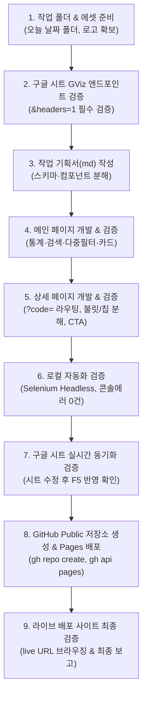

# 구글 시트 기반 실시간 정적 웹사이트 구축 & GitHub Pages 배포 워크플로우

본 스킬은 별도의 백엔드 데이터베이스 없이 **구글 스프레드시트를 실시간 No-DB CMS**로 사용하여, 누구나 시트를 수정하면 웹사이트에 즉시 반영되는 모던 반응형 2페이지(메인·상세) 사이트를 제작하고 GitHub Pages로 배포하는 전 과정을 표준화한 가이드입니다.

---

## 📌 핵심 원칙 (Core Rules)
1. **점진적 단계별 검증 (One Step at a Time)**: 한 번에 한 단계씩 진행하며, 각 단계가 정상 동작하는지 자동화 검증을 완료한 후 다음 단계로 진행합니다.
2. **날짜 기반 격리 작업**: 작업 요청 시마다 당일 날짜(예: `YYYY-MM-DD`) 폴더를 생성하여 모든 코드와 중간 산출물(스크립트, 스크린샷 등)을 격리 저장합니다.
3. **No-Build / Zero-Config 정적 구조**: 빌드 도구(Webpack/Vite 등) 없이 순수 HTML5, Vanilla CSS3, ES6+ JS 및 CDN(PapaParse)으로 구성하여 GitHub Pages에서 빌드 오류 없이 100% 즉시 동작하도록 합니다.
4. **실시간 동기화 보장 (Cache-Busting)**: 데이터 요청 시 매번 타임스탬프(`&_t=${Date.now()}`)를 부착하여 브라우저 및 CDN 캐시를 원천 차단합니다.

---

## 🚀 9단계 표준 작업 프로세스 (Work Breakdown Structure)



---

### Step 1: 작업 폴더 및 에셋 준비
- 오늘 날짜 형식(`YYYY-MM-DD`)의 작업 디렉터리를 생성합니다.
- 조직/기관의 공식 브랜드 로고(SVG 권장) 및 파비콘을 `assets/` 디렉터리에 준비합니다.

### Step 2: 구글 시트 GViz 엔드포인트 및 PapaParse 데이터 검증
- **공유 설정 확인**: 구글 시트가 "링크가 있는 모든 사용자(뷰어 이상)"로 공개되어 있는지 확인합니다.
- **엔드포인트 구성**:
  ```text
  https://docs.google.com/spreadsheets/d/{SHEET_ID}/gviz/tq?tqx=out:csv&sheet={SHEET_NAME}&headers=1
  ```
  > ⚠️ **[치명적 주의사항 - headers=1]**: 구글 GViz 기본 CSV 호출 시 상위 행들을 다중 행 헤더로 자동 오인하여 데이터 행이 대거 누락되는 고질적 버그가 있습니다. 반드시 `&headers=1` 파라미터를 추가하여 1행만 헤더로 고정해야 모든 행이 무결하게 파싱됩니다.
- Python 스크립트 또는 curl로 실제 행 수와 컬럼명을 1회 사전 조회하여 유효성을 검증합니다.

### Step 3: 작업 기획서(`PLAN.md`) 작성
- 개발에 착수하기 전, 아래 내용을 포함하는 종합 기획서를 마크다운으로 작성하여 폴더에 저장합니다:
  - 17개 전후 컬럼 스키마 및 매핑 정의
  - 프론트엔드 디자인 시스템 (기관 시그니처 색상, 타이포그래피, 뱃지 스타일)
  - 메인 페이지 구성요소 (헤더, 통계 카드, 검색/필터 바, 카드 그리드/테이블 뷰, 푸터)
  - 상세 페이지 구성요소 (브레드크럼, 핵심 스펙 6개 그리드, 불릿 리스트, 커리큘럼 칩, 신청/전화 CTA, 추천 과정)
  - 단계별 체크리스트 및 상태 표

### Step 4: 메인 페이지 개발 (`index.html`, `style.css`, `api.js`, `main.js`)
1. **`api.js` (실시간 통신 모듈)**:
   ```javascript
   const SHEET_CONFIG = {
     sheetId: 'YOUR_SHEET_ID',
     sheetName: 'data',
     get csvUrl() {
       return `https://docs.google.com/spreadsheets/d/${this.sheetId}/gviz/tq?tqx=out:csv&sheet=${encodeURIComponent(this.sheetName)}&headers=1&_t=${Date.now()}`;
     }
   };
   ```
2. **`main.js` (인터랙션 로직)**:
   - 스켈레톤 로딩 카드 렌더링 → 비동기 데이터 수신
   - 실시간 데이터 기반 통계 카운터 동적 계산 (전체 과정 수, 필수 과정 수 등)
   - 카테고리 칩 자동 추출 및 카운트 뱃지 표시
   - 200ms 디바운스 실시간 검색 및 다중 드롭다운 필터(대상, 구분, 방식 등)
   - 카드 그리드 뷰 및 테이블 뷰 토글
   - 상세페이지 이동 링크: `detail.html?code=${encodeURIComponent(course.code)}`
3. **`style.css` (디자인 시스템)**:
   - 모바일/태블릿/데스크톱 완벽 반응형 그리드
   - 상태별 직관적인 색상 뱃지 (필수: 레드, 권장: 블루, 선택: 그린)
   - 카드 호버 리프트 효과(`transform: translateY(-4px)`)

### Step 5: 상세 페이지 개발 (`detail.html`, `detail.js`)
- URL 파라미터 해석: `new URLSearchParams(window.location.search).get('code')`
- 누락되거나 잘못된 코드 접근 시 에러 메시지 및 메인 복귀 링크 제공
- 텍스트 분해: 시트 내 구분자(` · ` 등)가 포함된 학습목표 및 커리큘럼을 배열로 분리하여 불릿 리스트 및 칩 카드로 시각화
- 전화번호 자동 추출: 정규식 `[\d-]{9,14}`로 파싱하여 클릭 시 직통 통화(`tel:...`) 연동
- 수강신청 직통 CTA 버튼 (시트 내 신청 URL과 `target="_blank"` 연동)
- 링크 복사(공유) 버튼: `navigator.clipboard.writeText(location.href)`
- 추천 연수 과정: 동일 분야(Category)의 다른 코스 3종 자동 큐레이션

### Step 6: 로컬 자동화 검증 (Selenium Headless)
- 백그라운드 로컬 웹 서버 가동 (`python -m http.server 8080`)
- Selenium Edge/Chrome Headless 테스트 스크립트 작성 및 실행:
  - 32개 전체 카드 정상 렌더링 확인
  - 통계 수치 정확도 검증
  - 검색어 입력 시 실시간 필터링 동작 확인
  - 카드 클릭 시 상세 페이지로의 라우팅 검증
  - 브라우저 콘솔 심각 오류(`SEVERE`) 0건 확인
  - 시각적 레이아웃 스크린샷 자동 저장

### Step 7: 구글 시트 실시간 동기화 검증
- 구글 시트의 임의 셀 수정 후 웹 브라우저 새로고침(`F5`) 시 변경 사항이 즉각 반영되는지 확인.

### Step 8: GitHub Public 저장소 생성 및 GitHub Pages 배포
- `git init`, `git add .`, `git commit` (기본 브랜치 `main`)
- GitHub CLI(`gh`)를 통한 원클릭 배포:
  ```powershell
  # 1. 새 Public 리포지토리 생성 및 푸시
  gh repo create <repo-name> --public --source=. --remote=origin --push

  # 2. GitHub Pages 활성화 (main 브랜치 루트)
  gh api repos/:owner/<repo-name>/pages -X POST -F "source[branch]=main" -F "source[path]=/"

  # 3. 배포 워크플로우 완료 확인
  gh run list --repo :owner/<repo-name>
  ```

### Step 9: 라이브 배포 사이트 최종 검증 및 보고
- 배포된 GitHub Pages 실서비스 URL(`https://<owner>.github.io/<repo-name>/`)에 Headless 브라우저로 접속하여 최종 무결성 검증.
- 배포 URL, 저장소 주소, 작업 기획서 파일 링크를 깔끔한 마크다운 리포트로 최종 정리.

---

## 💡 유용한 코드 스니펫

### 1. PapaParse CSV 파싱 파이프라인
```javascript
Papa.parse(csvText, {
  header: true,
  skipEmptyLines: 'greedy',
  complete: function(results) {
    const validRows = results.data.filter(r => r['과정코드'] && r['과정코드'].trim() !== '');
    // 비즈니스 모델로 매핑...
  }
});
```

### 2. URL 링크 클립보드 복사 폴백 (HTTPS 및 일반 환경 대응)
```javascript
async function copyPageUrl() {
  if (navigator.clipboard && window.isSecureContext) {
    await navigator.clipboard.writeText(window.location.href);
  } else {
    const tempInput = document.createElement('input');
    tempInput.value = window.location.href;
    document.body.appendChild(tempInput);
    tempInput.select();
    document.execCommand('copy');
    document.body.removeChild(tempInput);
  }
  alert('과정 링크가 복사되었습니다.');
}
```
